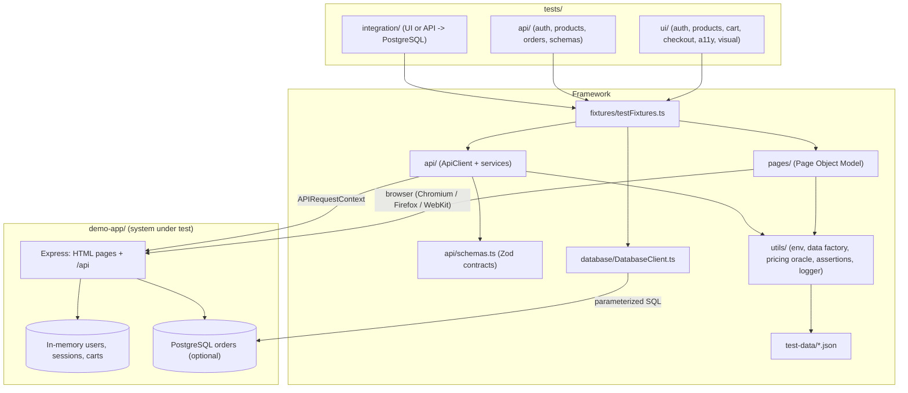

# Architecture

ShopSure has two halves that live in one repository but are kept strictly apart:

1. **The system under test** (`demo-app/`): a small e-commerce store with a server-rendered UI, a
   REST API, and optional PostgreSQL persistence. It exists so the tests have a target that is
   reproducible, offline-capable, and has a real API and database. It is deliberately small.
2. **The test framework** (everything else): page objects, API clients, schemas, fixtures, test data,
   database client, and the tests themselves.

The framework never imports application code. Expected values (catalogue prices, pricing rules,
response contracts) are written independently in `test-data/`, `utils/pricing.ts` and
`api/schemas.ts`, so a bug in the app cannot silently become a bug in the oracle.

## Layers

## Key design decisions

| Decision                                                                      | Why                                                                                                                                                                                |
| ----------------------------------------------------------------------------- | ---------------------------------------------------------------------------------------------------------------------------------------------------------------------------------- |
| Local demo app instead of a public demo site                                  | Public demo shops change, rate-limit, go offline, and rarely expose an API or database. A local target makes every run reproducible and lets CI run without external dependencies. |
| A fresh customer per test (`customer` fixture)                                | Each test gets its own empty cart and order history, so tests are order-independent and safe to run in parallel.                                                                   |
| Session cookie injection (`signedInCustomer`) instead of `storageState` files | Signs the browser in via the API in milliseconds, without UI login and without writing session tokens to disk. UI login is tested explicitly in `tests/ui/auth`.                   |
| API-driven arrangement                                                        | UI tests arrange carts through the API (`customer.cart.fill`) and spend browser time only on the behaviour being tested.                                                           |
| Zod schemas with `strictObject`                                               | Contracts fail on missing fields, wrong types _and_ unexpected extra fields (for example a leaked `passwordHash`).                                                                 |
| Named SQL in `database/queries.sql`                                           | All SQL is reviewable in one place and always executed with `$1` parameters.                                                                                                       |
| `db` fixture skips with a reason                                              | Database tests are optional. Without `DATABASE_URL`, or if the app is not storing orders in Postgres, they are skipped with an explanation instead of failing.                     |
| Seeded test data (`TEST_DATA_SEED`)                                           | Failing tests attach their seed, so the same names/emails/quantities can be replayed. Unique identifiers also include a run id so reruns never collide.                            |
| Redacted API exchange log                                                     | Every API call is recorded with passwords and tokens replaced by `[REDACTED]`, and attached to the report only when a test fails.                                                  |

## Projects (playwright.config.ts)

| Project    | Runs                                              | Browser         |
| ---------- | ------------------------------------------------- | --------------- |
| `api`      | `tests/api/**`, `tests/integration/*.api.spec.ts` | none            |
| `chromium` | `tests/ui/**`, `tests/integration/*.ui.spec.ts`   | Desktop Chrome  |
| `firefox`  | same as chromium, minus `@visual`                 | Desktop Firefox |
| `webkit`   | same as chromium, minus `@visual`                 | Desktop Safari  |

The `webServer` block starts the demo store (`npm run app:start`) before tests and waits for
`/health`. Set `START_LOCAL_SERVER=false` and `BASE_URL` to point the suite at another deployment
of the same app.

## Demo store behaviour (the contract the tests encode)

- Accounts: `standard_user` (customer), `locked_user` (locked), `admin_user` (admin). Passwords come from `.env`.
- Catalogue: 12 read-only seed products in 4 categories; one is out of stock. Admins can create
  extra products, which tests delete again.
- Pricing: subtotal + 8% tax (rounded to the cent) + $5.00 shipping below a $50.00 subtotal, free from $50.00.
- Quantity per cart line: 1-10.
- Orders: placed from the cart or an explicit item list; de-duplicated by checkout token (UI) or
  `Idempotency-Key` header (API); owners and admins can read them, others get 404; `PLACED -> CANCELLED` only.
